  

# 🤖 Awesome Multi-Agent Systems (MAS)

  
  
  
  
  
  
  

---

## 🧭 Executive Summary & SEO Guide

**Awesome Multi-Agent Systems** is the definitive, community-curated encyclopedia and guide covering **Autonomous AI Agents**, **Multi-Agent Orchestration Frameworks**, **Agentic AI Workflow Engines**, and **Enterprise LLM Workforces**. 

Moving beyond basic single-prompt chatbots, modern multi-agent systems leverage collaborative ensembles of specialized LLM agents (planners, coders, tool-callers, evaluators, and verifiers) capable of stateful execution, persistent memory retrieval, self-correction, and deterministic business outcome delivery.

### 🔍 Key Industry Topics Covered
`multi-agent-systems` • `autonomous-agents` • `ai-agents` • `llm-agents` • `agent-orchestration` • `langgraph` • `crewai` • `autogen` • `metagpt` • `stateful-graphs` • `role-based-crews` • `agentic-workflows`

---

## 📑 Table of Contents

- [🌐 Sector Overview & Market Dynamics](#-sector-overview--market-dynamics)
- [🏢 Enterprise & Commercial SaaS Platforms](#-enterprise--commercial-saas-platforms)
- [💻 Open-Source Multi-Agent Frameworks](#-open-source-multi-agent-frameworks)
- [📊 Architectural Comparison Matrix](#-architectural-comparison-matrix)
- [🛠️ How to Contribute](#️-how-to-contribute)
- [⭐ Star History](#-star-history)
- [💖 Support & Community](#-support--community)
- [⚖️ Disclaimer](#️-disclaimer)

---

## 🌐 Sector Overview & Market Dynamics

- **Market Size & Exponential Trajectory**: The global market for **Autonomous AI Agents & Multi-Agent Orchestration Platforms** reached an estimated **$5.1 billion in 2024** and is projected to surge past **$47.1 billion by 2030**, reflecting a blistering Compound Annual Growth Rate (**CAGR**) of **44.8%**. This expansion is propelled by enterprises shifting from exploratory generative AI copilots to autonomous multi-agent task execution.
- **Market Structure & Fragmentation**: The multi-agent systems sector is currently **moderately to highly fragmented** rather than a winner-take-all monopoly. Disparate architectural paradigms—explicit directed state machines (LangGraph), role-based hierarchical crews (CrewAI), conversational consensus loops (AutoGen/MetaGPT), and actor-model systems—cater to vastly different technical and compliance profiles. While specialized commercial platforms (Sierra, Decagon, Cognition Devin) capture lucrative high-ACV enterprise workflows, modular open-source frameworks dominate developer adoption, local execution, and private cloud deployments.

---

## 🏢 Enterprise & Commercial SaaS Platforms

The table below catalogs premier commercial SaaS multi-agent platforms and managed orchestration cloud environments, sorted in **descending order by company valuation / revenue scale**.

| 🏷️ Platform | 💰 Company Valuation / Revenue | 🎯 Core Focus & Architecture | 💳 Starting Tier Pricing | 🎁 Free Tier / Trial Limits |
| :--- | :--- | :--- | :--- | :--- |
| **[Sierra AI](https://sierra.ai/)** | **$10.0B Valuation** *(Series C, $200M ARR)* | Enterprise customer-facing autonomous multi-agent systems with deterministic compliance and CRM integration | **$50,000 / year** baseline platform fee + outcome-based resolution pricing *(typical entry contract ~$150,000/yr)* | **14-day sales-guided POC sandbox** *(custom enterprise pilot with up to 1,000 test resolutions; no self-serve free tier)* |
| **[Decagon](https://decagon.ai/)** | **$4.5B Valuation** *(Series D, $50M+ ARR)* | Enterprise autonomous support agents & voice/chat workforce operating procedures | **$50,000 / year** baseline platform fee + usage-based per-resolution fees *(typical ACV $95,000–$380,000+)* | **30-day scoped enterprise POC trial** upon sales qualification *(custom staging environment with 5,000 test interactions)* |
| **[Cognition Devin](https://devin.ai/)** | **$2.0B – $4.0B Valuation** *(Series A/B unicorn)* | Autonomous software engineering agent capable of end-to-end bug fixing, test writing, and repo refactoring | **$20 / month** *(Devin Pro)* *(Team seats start at $40/user/mo with $80/mo minimum)* | **Free forever plan ($0/mo)** with Devin Review, DeepWiki, inline edits, tab completions, and light monthly sandbox runs |
| **[LangGraph Cloud / Platform](https://www.langchain.com/langgraph)** | **$1.25B Valuation** *(LangChain Series B unicorn)* | Managed cloud hosting and durable server execution for stateful LangGraph agents with LangSmith observability | **$39 / user / month** *(LangSmith Plus)* + **$0.001** per cloud node execution | **Free forever Developer plan**: 1 user seat, 5,000 base traces/month, and up to 100,000 cloud node executions/month |
| **[CrewAI Cloud & Enterprise](https://www.crewai.com/)** | **~$200M Valuation** *(Venture backed, $18M+ raised)* | Cloud-managed role-based crew orchestration, visual pipeline builder, agent tracing, and production guardrails | **$25 / month** *(Basic / Starter cloud tier)* | **Free forever plan ($0/mo)** with visual editor, tracing, and **up to 50 workflow executions per month** |
| **[Lindy AI](https://www.lindy.ai/)** | **~$200M Valuation** *($49.9M funding raised)* | Autonomous executive productivity agents, multi-agent calendar scheduling, email automation, and tool routing | **$29.99 / user / month** *(Plus plan with ~3,000 workspace credits)* | **7-day free trial** with full Pro feature access and 1,000 trial workflow credits *(credit card required for verification)* |
| **[AutoGPT Cloud](https://agpt.co/)** | **~$100M Valuation** *(Significant Gravitas)* | Managed autonomous goal-decomposition agents, visual workflow canvas, Otto AI experts, and agent credit wallet | **$50 / month** *(Pro plan with visual builder and multi-model access)* | **7-day free trial** on Pro tier + **100% free forever self-hosted open-source core** on local infrastructure |
| **[Fixie.ai / Ultravox](https://fixie.ai/)** | **$51.5M Valuation** *(Acquired by Inworld AI)* | Real-time multimodal voice-to-voice agent coordination and low-latency speech infrastructure | **$100 / month** *(Pro plan with low-latency dedicated endpoints; overage at $0.05/min)* | **Free forever Developer Sandbox**: includes **30 free conversation minutes per month** with standard speech models |

---

## 💻 Open-Source Multi-Agent Frameworks

Below is the curated list of premier open-source multi-agent systems and developer frameworks. Each framework includes an active live social badge linking directly to that repository's **stargazers page**, sorted in **descending order by GitHub Stars_Count**.

---

### 1. [AutoGPT](https://github.com/Significant-Gravitas/AutoGPT) 
- **GitHub Repository**: [Significant-Gravitas/AutoGPT](https://github.com/Significant-Gravitas/AutoGPT)
- **License**: MIT
- **Primary Focus**: Autonomous goal decomposition, recursive task execution, and agentic desktop/cloud workflows.
- **Key Features**: 
  - Pioneered the autonomous agent ecosystem with recursive planning and memory retention.
  - Complete ecosystem including Forge (agent building blocks), Benchmark (agbenchmark), and Frontend visual builder.
  - Integration with diverse web scrapers, local file systems, and external vector memory stores.
- **Best For**: Developers researching autonomous goal pursuit and teams seeking self-hosted autonomous agent infrastructure.

---

### 2. [MetaGPT](https://github.com/FoundationAgents/MetaGPT) 
- **GitHub Repository**: [FoundationAgents/MetaGPT](https://github.com/FoundationAgents/MetaGPT)
- **License**: MIT
- **Primary Focus**: Standard Operating Procedures (SOPs) encoded into multi-agent collaborative software teams.
- **Key Features**:
  - Assigns diverse simulated corporate roles: Product Manager, Architect, Project Manager, Engineer, and QA Tester.
  - Outputs full end-to-end software deliverables: user stories, competitive analysis, system design diagrams (Mermaid), and codebases.
  - Human-like communicative structure minimizing hallucinations through structured artifact exchanges.
- **Best For**: Complex software development simulations and multi-role collaborative artifact generation.

---

### 3. [AutoGen (Microsoft)](https://github.com/microsoft/autogen) 
- **GitHub Repository**: [microsoft/autogen](https://github.com/microsoft/autogen)
- **License**: MIT
- **Primary Focus**: Conversational multi-agent orchestration, event-driven actor loops, and extensible team patterns.
- **Key Features**:
  - Dual-layer architecture: high-level **AgentChat** (RoundRobin, Selector, MagenticOne, Swarm) and low-level event-driven **Core**.
  - Flexible human-in-the-loop interruption mechanisms and modular tool invocation.
  - Stateful session persistence via built-in `save_state()` and `load_state()`.
- **Best For**: Conversational agent research and legacy AutoGen deployments *(note: Microsoft recommends Microsoft Agent Framework for greenfield enterprise projects)*.

---

### 4. [CrewAI](https://github.com/crewAIInc/crewAI) 
- **GitHub Repository**: [crewAIInc/crewAI](https://github.com/crewAIInc/crewAI)
- **License**: MIT
- **Primary Focus**: Role-based agent crews with natural organizational abstractions and deterministic event flows.
- **Key Features**:
  - High developer ergonomics: intuitive modeling of `Agent`, `Task`, and `Crew`.
  - **CrewAI Flows**: allows combining autonomous role-based crews with deterministic, stateful Python procedural logic.
  - Hierarchical and sequential execution modes with automated agent delegation and output validation.
- **Best For**: Fast production prototyping, content pipelines, automated market research, and role-driven business operations.

---

### 5. [LangGraph](https://github.com/langchain-ai/langgraph) 
- **GitHub Repository**: [langchain-ai/langgraph](https://github.com/langchain-ai/langgraph)
- **License**: MIT
- **Primary Focus**: Production-grade cyclical state machines, Pregel-inspired supersteps, and durable execution.
- **Key Features**:
  - Treats agent interactions as explicit nodes and conditional edges on a directed cyclic graph.
  - Durable persistence: built-in checkpointers (Postgres, SQLite, Memory) supporting time-travel debugging and human-in-the-loop rewinds.
  - Dynamic map-reduce via `Send()` commands and parallel execution branches with complete state traceability.
- **Best For**: Enterprise engineering teams requiring deterministic control, state audibility, and failure-resilient long-running multi-agent systems.

---

### 6. [Agno (formerly Phidata)](https://github.com/agno-agi/agno) 
- **GitHub Repository**: [agno-agi/agno](https://github.com/agno-agi/agno)
- **License**: MIT
- **Primary Focus**: High-speed, lightweight multi-agent architectures with memory, knowledge, and structured outputs.
- **Key Features**:
  - Extremely low latency: engineered with minimal framework bloat and native async support.
  - First-class multi-modal support (text, images, audio, video) and native vector database connectors.
  - Multi-agent teams with team leads, hierarchical task routing, and autonomous tool calling.
- **Best For**: High-throughput production APIs, real-time multimodal agent interactions, and streamlined microservices.

---

### 7. [ChatDev](https://github.com/OpenBMB/ChatDev) 
- **GitHub Repository**: [OpenBMB/ChatDev](https://github.com/OpenBMB/ChatDev)
- **License**: Apache-2.0
- **Primary Focus**: Virtual software development company simulated through communicative multi-agent role-playing.
- **Key Features**:
  - Multi-agent waterfall software lifecycle: Designing, Coding, Testing, and Documenting.
  - ChatChain mechanism: decomposes development phases into atomic interactive conversational steps between specialized agents.
  - Interactive visual replay interface allowing step-by-step inspection of agent dialogues and generated artifacts.
- **Best For**: Studying multi-agent communicative emergent behavior and rapid prototyping of small programs.

---

### 8. [GPT Researcher](https://github.com/assafelovic/gpt-researcher) 
- **GitHub Repository**: [assafelovic/gpt-researcher](https://github.com/assafelovic/gpt-researcher)
- **License**: Apache-2.0
- **Primary Focus**: Autonomous research multi-agent system for web scraping, source filtering, and comprehensive report synthesis.
- **Key Features**:
  - Multi-agent pipeline: planner agent creates research outlines, sub-agents parallelize web scraping, and reviewer synthesizes cited reports.
  - Aggregates over 20+ web sources per query with built-in deduplication and objective fact-checking routines.
  - Supports markdown, PDF, docx exports, and seamless integration with LangGraph or CrewAI pipelines.
- **Best For**: Deep financial diligence, automated market research, academic literature synthesis, and legal briefs.

---

### 9. [smolagents](https://github.com/huggingface/smolagents) 
- **GitHub Repository**: [huggingface/smolagents](https://github.com/huggingface/smolagents)
- **License**: Apache-2.0
- **Primary Focus**: Lightweight, code-first agent framework developed by Hugging Face with minimal abstraction overhead.
- **Key Features**:
  - CodeAgent philosophy: agents write native executable Python code blocks rather than bulky JSON schemas, reducing token consumption by ~30%.
  - Built-in secure local execution sandbox (`E2B` or local AST parser) and native Hugging Face Hub integration.
  - Support for multi-agent delegation via manager-worker patterns.
- **Best For**: Developers seeking transparent, minimalist code-centric agents without heavyweight framework magic.

---

### 10. [Semantic Kernel](https://github.com/microsoft/semantic-kernel) 
- **GitHub Repository**: [microsoft/semantic-kernel](https://github.com/microsoft/semantic-kernel)
- **License**: MIT
- **Primary Focus**: Enterprise-grade multi-agent orchestration SDK spanning Python, C# (.NET), and Java.
- **Key Features**:
  - First-class multi-language enterprise architecture with seamless Microsoft Azure OpenAI and Copilot integration.
  - Experimental Agent Framework supporting agent chat, broadcast groups, and multimodal multi-agent coordination.
  - Native plugins, memory connectors, and OpenTelemetry instrumentation for enterprise observability.
- **Best For**: Enterprise .NET and Python shops building production multi-agent systems aligned with Microsoft cloud infrastructure.

---

### 11. [Letta (formerly MemGPT)](https://github.com/letta-ai/letta) 
- **GitHub Repository**: [letta-ai/letta](https://github.com/letta-ai/letta)
- **License**: Apache-2.0
- **Primary Focus**: Stateful multi-agent systems with tiered operating-system-like hierarchical memory management.
- **Key Features**:
  - Implements OS-style virtual memory paging: Core Memory (in-context), Archival Memory (vector store), and Recall Memory (message history).
  - Multi-agent collaboration with inter-agent messaging and shared memory blocks.
  - Self-editing memory tools allowing agents to autonomously update knowledge bases across sessions.
- **Best For**: Long-term conversational agents, persistent digital personas, and memory-intensive enterprise workflows.

---

### 12. [PydanticAI](https://github.com/pydantic/pydantic-ai) 
- **GitHub Repository**: [pydantic/pydantic-ai](https://github.com/pydantic/pydantic-ai)
- **License**: MIT
- **Primary Focus**: Type-safe, Pythonic agent framework built on top of Pydantic validation by the official Pydantic team.
- **Key Features**:
  - Strict type safety and validation on agent inputs, dependency injections, and output schemas.
  - Model-agnostic design with out-of-the-box support for OpenAI, Anthropic, Gemini, Groq, and Ollama.
  - Structured multi-agent delegation patterns with durable validation errors and automated retry loops.
- **Best For**: Production Python teams who treat runtime validation, static type-checking, and IDE autocomplete as critical requirements.

---

### 13. [CAMEL](https://github.com/camel-ai/camel) 
- **GitHub Repository**: [camel-ai/camel](https://github.com/camel-ai/camel)
- **License**: Apache-2.0
- **Primary Focus**: Communicative agent framework for exploring cooperative and competitive multi-agent game-theoretic dynamics.
- **Key Features**:
  - Role-Playing framework: autonomous inception prompting that enables agents to solve tasks with zero human intervention.
  - Support for multi-agent societies, workforce simulations, and complex tool-augmented environments.
  - Comprehensive multimodal data generation capabilities for fine-tuning open-source LLMs.
- **Best For**: Academic research in multi-agent communication, societal simulations, and automated dataset curation.

---

### 14. [SuperAGI](https://github.com/TransformerOptimus/SuperAGI) 
- **GitHub Repository**: [TransformerOptimus/SuperAGI](https://github.com/TransformerOptimus/SuperAGI)
- **License**: MIT
- **Primary Focus**: Developer-first autonomous agent infrastructure with graphical management console and tool marketplace.
- **Key Features**:
  - Web GUI for provisioning, spawning, tracking, and monitoring concurrent autonomous agent runs.
  - Rich marketplace of modular toolkits (GitHub, Jira, Google Search, Twitter, Slack, Vector DBs).
  - Built-in performance telemetry, agent trajectory logging, and multi-vector database storage adapters.
- **Best For**: Developers seeking an out-of-the-box self-hosted platform with a GUI console and modular plug-in tools.

---

## 📊 Architectural Comparison Matrix

| 🛠️ Framework | 🌟 Star Ranking | 🏗️ Architecture Style | 💾 State / Memory Model | ⚡ Learning Curve | 🛡️ Best Production Use Case |
| :--- | :--- | :--- | :--- | :--- | :--- |
| **AutoGPT** | ⭐ 187k+ | Goal Decomposition Loop | Vector & Local Disk | Moderate | Autonomous task search & desktop automation |
| **MetaGPT** | ⭐ 70k+ | Structured SOP Assembly | Shared Document Artifacts | Moderate | Multi-role end-to-end software simulation |
| **AutoGen** | ⭐ 61k+ | Conversational Actor Loops | Event-based `save_state()` | Moderate | Conversational agent swarms & research |
| **CrewAI** | ⭐ 60k+ | Role-Based Crews & Flows | SQLite / Vector Short-Term | Gentle | Content pipelines & business role decomposition |
| **LangGraph** | ⭐ 43k+ | Cyclical Directed State Graph | Multi-layer Checkpointing | Steep | Complex enterprise workflows & time-travel audits |
| **Agno** | ⭐ 42k+ | Lightweight Fast Agents | Postgres / Vector RAG | Gentle | High-concurrency APIs & multimodal streaming |
| **ChatDev** | ⭐ 34k+ | ChatChain Phase Stages | Conversational History | Gentle | Software development life-cycle simulation |
| **GPT Researcher** | ⭐ 30k+ | Multi-Agent Research DAG | In-memory Research Outlines | Gentle | Automated web research & cited synthesis |
| **smolagents** | ⭐ 30k+ | Code-as-Action (Python) | In-Memory AST State | Gentle | Minimalist code-centric agent execution |
| **Semantic Kernel** | ⭐ 28k+ | Plugin-Native Kernel | Azure AI Search & Memory | Moderate | Enterprise .NET / Python Azure implementations |
| **Letta (MemGPT)** | ⭐ 25k+ | OS Hierarchical Virtual Memory | Paged Core/Archival/Recall | Moderate | Long-term conversational state & persona agents |
| **PydanticAI** | ⭐ 20k+ | Type-Safe Model Graphs | Pydantic Schema Validation | Gentle | Production Python microservices & API validation |
| **CAMEL** | ⭐ 17k+ | Role-Playing Inception | Multi-Agent Message Buffer | Moderate | Communicative behavior research & data generation |
| **SuperAGI** | ⭐ 17k+ | GUI Concurrent Engine | Multi-Vector DB Storage | Moderate | Self-hosted agent console with GUI controls |

---

## 🛠️ How to Contribute

We welcome contributions from researchers, framework authors, and production practitioners!

1. 🍴 **Fork the Repository** on GitHub.
2. 🌿 **Create a Feature Branch**: `git checkout -b feature/add-new-framework`.
3. 📝 **Add or Update Entries**:
   - Provide accurate links to official repositories or official websites.
   - For SaaS products: include specific starting prices, specific free tier limits, and verifiable revenue/valuation metrics.
   - For open-source repos: include shields.io social Stars_Badge linking to the stargazers page.
4. ✅ **Ensure Formatting Consistency**: Maintain alphabetical or metric-based sorting as designated in the respective sections.
5. 🚀 **Submit a Pull Request** with a clear explanation of additions.

---

## ⭐ Star History

---

## 💖 Support & Community

Thank you for exploring and utilizing the **Awesome Multi-Agent Systems** directory! If this resource has helped your research, architecture planning, or engineering workflows, please consider supporting the project:

- ⭐ **Star this repository** to help others discover it across GitHub.
- 🍴 **Fork the repo** to contribute updates, corrections, or new frameworks.
- 📢 **Share with your team** and post on Twitter/X, LinkedIn, or Discord.
- ☕ **Support the maintainer**: Buy a coffee and sponsor ongoing curation via the [GitHub Sponsor Dashboard](https://github.com/sponsors/ishandutta2007).

  

---

## ⚖️ Disclaimer

- This catalog is a **community-curated index** compiled for informational, architectural, and educational purposes; inclusion does not constitute a commercial endorsement.
- All product names, logos, and brands are property of their respective owners.
- Pricing, free tier allowances, and valuation estimates fluctuate over time; verify current commercial terms on vendors' official websites.
- When deploying autonomous multi-agent systems to production, implement robust guardrails, token rate-limiting, sandboxed execution environments, and strict human-in-the-loop oversight to prevent unintended actions or runaway cloud expenditures.

---

  <b>Built with ❤️ for the global AI Engineering and Multi-Agent Systems community.</b>

